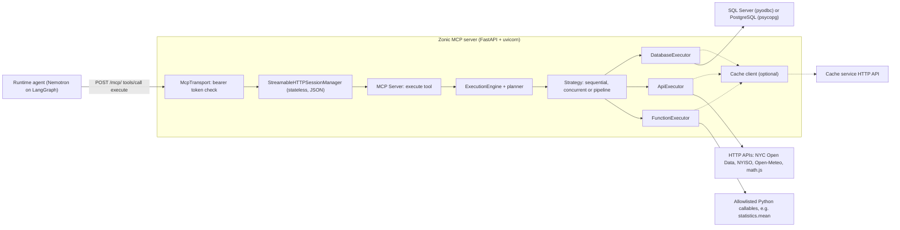
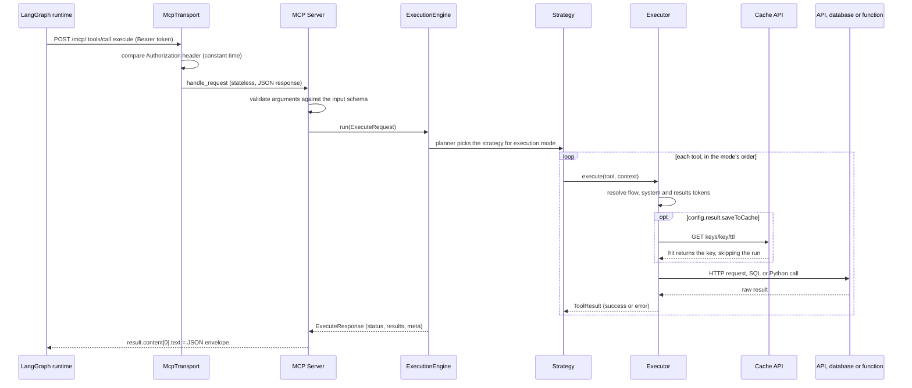

# Technical design: Zonic MCP Server (FastAPI)

How this repository is built. Setup, commands and the hackathon summary are in the [README](../README.md).

This section describes how the server is built. The platform-wide architecture (builder,
runtime, chat app and gateway) is in the runtime's README:
[The platform](https://github.com/TripleQAI/ZonicAgentRuntimeBackend_Python_LangGraph#the-platform).

## Architecture

The server has one business surface: an MCP endpoint at `/mcp` with one tool, `execute`.
A caller does not pick from a list of server-side tools. It sends the tool definitions
themselves (an API call, a SQL script, a Python callable) with the values to run them
with, and the server runs them and returns one result per tool.

| Layer | Code | What it does |
|---|---|---|
| Hosting | [app/main.py](../app/main.py) | FastAPI app under uvicorn. Mounts the MCP transport at `/mcp` and `/mcp/`, serves `GET /health`, answers 406 on any other path. No OpenAPI document or docs pages. |
| Transport | [app/main.py](../app/main.py) (`McpTransport`) | Checks the bearer token, then hands the raw ASGI request to the MCP SDK's `StreamableHTTPSessionManager` (stateless, JSON responses). |
| MCP server | [app/mcp_server/server.py](../app/mcp_server/server.py) | Low-level `mcp.server.lowlevel.Server` with `list_tools` (one tool and its input schema) and `call_tool` (parse, run the engine, return the JSON envelope as text). |
| Engine | [app/engine/engine.py](../app/engine/engine.py), [planner.py](../app/engine/planner.py), [strategies/](../app/engine/strategies) | Builds the execution context, picks a strategy by `execution.mode`, runs it and computes the batch status. |
| Executors | [app/engine/executors/](../app/engine/executors) | `database`, `api` and `function`, loaded from `EXECUTOR_TYPES` (type → class path) and kept as one instance each. |
| Infrastructure | [app/infra/](../app/infra) | Pooled `httpx.AsyncClient`, the cache service client, named database connections, `<placeholder>` substitution and the `{{token}}` resolver. |
| Models | [app/models/](../app/models) | Dataclasses of the request (`ExecuteRequest`, `ToolSpec`, `ExecutionConfig`), the response (`ExecuteResponse`, `ToolResult`, `ToolMeta`, `ResponseMeta`) and the output envelope (`CachedResult`). |



The client is the LangGraph runtime. Each database, api or function tool configured on an
agent node becomes a tool the model sees, with the document's name, description and input
schema. When the model calls it, the runtime resolves the tool's secret references, then
sends one `execute` request with that tool's definition as `config`, the model's arguments
as `input`, and the run's `flow` and `system` values as `context`. Its `requestId` is the
call's idempotency key (`runId:nodeId:visit:callIndex`). A per-tool error goes back to the
model as a tool error, so the model can correct its arguments.

## The execute contract

`execute` takes a JSON object. The MCP SDK validates it against the tool's input schema
before the engine runs, so an unknown `mode` or tool `type` is refused there.

| Field | Type | Meaning |
|---|---|---|
| `requestId` | string | Echoed in the response. Generated (UUID4) when absent. |
| `context.flow`, `context.system` | object | Values that `{{flow.x}}` and `{{system.x}}` tokens resolve against. |
| `execution.mode` | `sequential` (default), `concurrent`, `pipeline` | How the tools run together (see Execution engine). |
| `execution.maxConcurrency`, `execution.failFast` | integer, boolean | Accepted and parsed. The strategies do not read them yet: concurrency comes from the `MAX_CONCURRENCY` setting. |
| `tools[]` (required) | array | The tools to run. |
| `tools[].id`, `tools[].type` (required) | string | A unique ID within the request, and `database`, `api` or `function`. |
| `tools[].config` | object | The tool definition: type-specific settings (see Executors). |
| `tools[].input` | object | The call's values: placeholder values, function arguments. |
| `tools[].dependsOn`, `tools[].stage` | array of IDs, integer | Dependencies used by `pipeline` mode. |

Before a tool runs, its `config` and `input` pass through the resolver
([app/infra/resolver.py](../app/infra/resolver.py)). `{{flow.path}}`, `{{system.path}}` and
`{{results.<toolId>.<path>}}` are replaced from the context and from earlier tools'
outputs. A string that is exactly one token keeps the value's type (a list stays a list);
a token inside a longer string is interpolated as text.

**Example.** An NYC Open Data (Socrata) query whose `$where` value comes from the run's
flow, and a `statistics.mean` call, run concurrently. The API tool is the shape the
`facility_operations_swarm` template uses (see
[tests/engine/test_api_placeholders.py](../tests/engine/test_api_placeholders.py)).

```json
{
  "jsonrpc": "2.0", "id": 1, "method": "tools/call",
  "params": {
    "name": "execute",
    "arguments": {
      "requestId": "demo-1",
      "context": { "flow": { "periodStartMonth": "2025-01" } },
      "execution": { "mode": "concurrent" },
      "tools": [
        { "id": "bench", "type": "api",
          "config": {
            "method": "GET",
            "url": "https://data.cityofnewyork.us/resource/jr24-e7cr.json",
            "queryParams": { "$where": "revenue_month >= '<periodMonth>'", "$limit": "25" },
            "parameters": [ { "name": "periodMonth", "placeholder": "<periodMonth>",
                              "sourcePath": "{{flow.periodStartMonth}}" } ],
            "result": { "format": "json" } } },
        { "id": "mean", "type": "function",
          "config": { "functionPath": "statistics.mean", "callStyle": "args" },
          "input": { "data": [2, 4, 9] } }
      ]
    }
  }
}
```

The JSON-RPC result's `content[0].text` is a JSON string, the response envelope. Values in
angle brackets vary by call:

```
{
  "requestId": "demo-1",
  "status": "success",
  "results": {
    "bench": { "id": "bench", "status": "success",
               "output": { "is_cached": false, "data": { "variable": null, "value": [<rows>] } },
               "error": null, "meta": { "type": "api", "durationMs": <ms>, "cached": false } },
    "mean":  { "id": "mean", "status": "success",
               "output": { "is_cached": false, "data": { "variable": null, "value": 5 } },
               "error": null, "meta": { "type": "function", "durationMs": <ms>, "cached": false } }
  },
  "meta": { "totalDurationMs": <ms>, "toolCount": 2, "completed": 2, "flowUpdates": {} }
}
```

**Results and errors.**

- Every successful `output` has the same envelope, `{is_cached, data: {variable, value}}`.
  `value` is the data, or the cache key when `is_cached` is true; `data.preview` is added
  when the tool asked for one. A later tool reads a value with `{{results.<id>.data.value}}`.
- A tool that raises becomes `status: "error"` with `error: "<ExceptionClass>: <message>"`;
  the other tools still run. A message that mentions a password, secret, token, key or pwd
  is replaced by `<ExceptionClass>: <redacted>`.
- The batch `status` is `success` when every tool succeeded, `partial` when some failed,
  and `error` when none succeeded or there were no results. `meta.completed` counts
  successes.
- `meta.flowUpdates` is part of the contract (the runtime reads it); no executor writes to
  it yet, so it is `{}`.
- Problems outside a tool, such as an unknown MCP tool name or arguments that fail the input
  schema, come back as an MCP tool result with `isError: true`.

## Executors

All three extend `BaseExecutor` ([app/engine/executors/base.py](../app/engine/executors/base.py)),
a template method: resolve tokens in `config` and `input`, run the executor inside the
read-through cache, wrap the output in the envelope, and turn any exception into an error
result. Blocking work (pyodbc, psycopg, synchronous functions) runs in a worker thread with
`asyncio.to_thread`, so the event loop stays free.

**Database** ([app/engine/executors/database/](../app/engine/executors/database))

| Setting | Meaning |
|---|---|
| `config.connection` or `config.connectionName` | A connection name. Empty or `default` is the SQL Server connection from `DB_CONNECTION_STRING` or `MSSQL_*`; other names come from `DATABASE_CONNECTIONS`. A `postgresql://` or `postgres://` DSN is PostgreSQL, anything else an ODBC string for SQL Server. |
| `config.databaseType` | Optional. Must match the connection's kind, or the tool fails. |
| `config.queryType` | `script` (default) or `stored_procedure`. |
| `config.script`, `config.parameters` | The SQL and its `<placeholder>` parameters. Values are inlined with the connection dialect's encoder (below). |
| `config.procedureName`, `config.parameters` | SQL Server only. Runs `EXEC <name> ?, ...`; `IN` and `INOUT` parameters are bound from `input` by name. |
| `config.maxRows`, `config.queryTimeout` | Row cap per result set, and the query timeout in seconds (scripts). |

- A script returns its last result set as a list of row objects; statements without columns
  (`DECLARE`, `INSERT`) are skipped. A stored procedure returns `{"resultSets": [...]}`.
- Rows are fetched in batches of 1,000 (`fetchmany`), so raw driver rows are never all held
  at once.
- Each tool opens its own connection, commits on success, rolls back on error and closes it.
- PostgreSQL connections are read-only (`POSTGRES_READ_ONLY`, default true) and run with
  `statement_timeout` from `config.queryTimeout` or `POSTGRES_STATEMENT_TIMEOUT_SECONDS`.
- SQL encoders ([sql_encoders.py](../app/engine/executors/database/sql_encoders.py)): strings
  double their single quotes; `int`, `number`, `decimal` and `float` must match a number
  pattern; `date` and `datetime` must be ISO-8601; booleans become `1`/`0` on SQL Server and
  `true`/`false` on PostgreSQL. A value that fails validation fails the tool; unknown types
  use the string encoder.

**API** ([app/engine/executors/api/](../app/engine/executors/api))

| Setting | Meaning |
|---|---|
| `config.method` | Default `GET`. Must be in `ALLOWED_HTTP_METHODS` (default `GET, POST, PUT, PATCH, DELETE`). |
| `config.url`, `config.queryParams`, `config.headers` | The request. `input.queryParams` and `input.headers` are merged over the configured ones. |
| `config.bodyType` | `none` (default), `json`, `form` or anything else (sent as raw text). A body is sent only for POST, PUT and PATCH. |
| `config.bodyTemplate`, `config.bodyFormData` | The body; `input.body` and `input.formData` are used when the config has none. |
| `config.auth` | `bearer_token` (`envVar`), `api_key` (`envVar`, `header`, default `X-API-Key`) or `basic_auth` (`userEnvVar`, `passwordEnvVar`). The values are read from the server's environment. |
| `config.parameters` | `<placeholder>` parameters filled in the URL, query values, headers and body. |
| `config.result.format` | `json` (default; falls back to text when the body is not JSON) or anything else for text. |

- A parameter's value is `input[name]` when present, else its `sourcePath` (already resolved,
  so `{{flow.x}}` works), else its `defaultValue`. A `required` parameter with no value fails
  the tool.
- Each location has its own encoder ([encoders.py](../app/engine/executors/api/encoders.py)):
  percent-encoded in the URL, JSON-escaped in a `json` body, refused in a header when it
  contains a line break, and left to the HTTP client in query values. Number, date and boolean
  parameters are validated first, with the SQL encoders' rules.
- A tool without `parameters` is sent unchanged, so a literal `<...>` in a URL survives.
- A non-2xx response fails the tool (`raise_for_status`). Requests share one pooled client
  (100 connections, 20 keep-alive) with the `HTTP_TIMEOUT_SECONDS` timeout.

**Function** ([app/engine/executors/function/](../app/engine/executors/function))

| Setting | Meaning |
|---|---|
| `config.functionPath` | Required. `module.callable`, e.g. `statistics.mean`. Imported once and cached (up to 256 paths). |
| `config.callStyle` | `kwargs` (default): `fn(**input)`. `args`: `fn(*input.values())`, in insertion order. `single`: `fn(input)`. |

- `FUNCTION_ALLOWLIST` holds module prefixes: `statistics` allows `statistics.mean`. A path
  outside it fails with `PermissionError`. An empty list allows every callable, which is why
  the Lambda deployment refuses one.
- Coroutine functions are awaited; synchronous ones run in a worker thread.
- Dynamic registration (`FUNCTION_DYNAMIC_REGISTRATION_ENABLED`, off by default) can install a
  package on first use: it reads the package's config from `CONFIG_API_URL`, checks
  `FUNCTION_ALLOWED_MODULE_PREFIXES`, runs `pip install` (pinned distribution, `--require-hashes`
  when hashes are given, optional index URL), installs each package once behind a lock, and
  remembers failures for `FUNCTION_NEGATIVE_CACHE_TTL_SECONDS`. Details:
  [docs/DYNAMIC_FUNCTION_REGISTRATION.md](DYNAMIC_FUNCTION_REGISTRATION.md).

## Execution engine



**Modes** ([app/engine/strategies/](../app/engine/strategies))

| Mode | Order | Notes |
|---|---|---|
| `sequential` | One at a time, in list order | A tool can read any earlier tool's result. `dependsOn` is not enforced. |
| `concurrent` | All at once, under an `asyncio.Semaphore(MAX_CONCURRENCY)` | Tools should not reference each other's results. |
| `pipeline` | Levels from `dependsOn` (Kahn's topological sort); each level runs concurrently under the semaphore, and the next starts when it finishes | A tool whose dependency failed is not run: it gets `Skipped: dependency "<id>" failed.` `stage` only orders tools inside a level. A tool in a cycle, or one that depends on an ID not in the request, never becomes ready and gets no result, so `meta.completed` stays below `meta.toolCount`. |

**Limits and timeouts**

| Limit | Where it applies |
|---|---|
| `MAX_CONCURRENCY` (default 8) | Tools running at once within one request, in `concurrent` and `pipeline` modes. |
| `HTTP_TIMEOUT_SECONDS` (default 30) | Each API call, cache call and config API call (the pooled client's timeout). |
| `config.queryTimeout` / `POSTGRES_STATEMENT_TIMEOUT_SECONDS` (default 30) | SQL scripts; PostgreSQL falls back to the setting. |
| `config.maxRows` | Rows per result set. |
| Lambda timeout (120 s) | The whole request on the deployed function. |

`DEFAULT_CALL_TIMEOUT_SECONDS` is read only by `TimeoutDecorator` in
[app/engine/decorators/](../app/engine/decorators). The retry, timeout and trace decorators are
written but not yet applied to the executors, so a function tool has no per-call timeout of
its own.

**Cache** ([app/infra/cache.py](../app/infra/cache.py)). Caching is per tool and opt-in, and
the server talks to a separate cache service over HTTP:

- `config.result.saveToCache: true` needs `config.result.cacheKeyConfig.digest` and
  `config.result.saveToFlowKey`. The key is `mcp:` plus the SHA-256 of the digest, so the
  caller decides what makes two calls the same.
- The TTL is `config.result.ttlSeconds`, else `CACHE_DEFAULT_TTL_SECONDS` (1,800 in
  `Settings`; `.env.example` sets 300).
- A hit is detected with `GET keys/<key>/ttl`, without fetching the value, and the tool is not
  run. A miss runs the tool and stores the result with `PUT keys/<key>`. Either way the output
  is the key (`is_cached: true`, `variable` = the flow key), not the data; `meta.cached` is true.
- If the store is not confirmed, the data comes back inline: the caller never gets a key that
  points at nothing. Any cache error counts as a miss, and an empty `CACHE_API_URL` turns the
  cache off. The Lambda deployment runs with the cache off.

**Partial failure.** Each tool's exceptions stay inside its own result, so one slow or failing
upstream does not lose the others' data. The engine also catches an exception from the
strategy itself and returns whatever results it has.

## Security

| Control | How |
|---|---|
| Authentication | With `MCP_AUTH_TOKEN` set, `/mcp` requires `Authorization: Bearer <token>`, compared with `hmac.compare_digest`. Anything else gets 401 with `WWW-Authenticate: Bearer`. `/health` needs no token. An empty token leaves `/mcp` open, which is only safe on a private network. `deploy.sh` generates a 64-character token when none is set. |
| Surface | `/mcp`, `/mcp/` and `GET /health` only. No OpenAPI or docs pages; other paths get 406. |
| Input checks | The MCP SDK validates arguments against the input schema. Tool types and modes are enums. |
| HTTP methods | `ALLOWED_HTTP_METHODS` limits API tools' verbs. |
| Injection | Placeholder values are encoded for where they land (SQL literal, URL, header, JSON body), and typed values are validated, so a value cannot change the statement or request around it. |
| Functions | Only callables under `FUNCTION_ALLOWLIST` run. `deploy.sh` refuses an empty allowlist, one naming `builtins`, `os`, `sys`, `subprocess`, `importlib`, `shutil`, `pathlib`, `io` or `ctypes`, and dynamic registration. The deployed allowlist is `statistics`. |
| Secrets | Tools name a database connection; DSNs and passwords stay in the server's settings (`SecretStr`), and a connection's `repr` omits its DSN. API credentials are read from environment variables the tool names. On Lambda the settings live in an SSM SecureString parameter and the function's environment. Error messages that mention secrets are redacted. |
| Databases | PostgreSQL transactions are read-only by default and have a statement timeout. |
| Egress | The server has no host allowlist of its own: an API tool's URL comes from its definition in the workflow document, and the model's values are encoded into it. On Lambda the function runs outside a VPC, and its IAM role carries only `AWSLambdaBasicExecutionRole` (logs). |
| Container | The image runs as a non-root user (UID 10001). |

## Configuration and deployment

`Settings` ([app/config.py](../app/config.py)) is a `pydantic-settings` class. Values come from
environment variables, then `.env`; unknown variables are ignored. `get_settings()` loads
them once per process (`lru_cache`). Secrets (`MCP_AUTH_TOKEN`, `MSSQL_PASSWORD`,
`DB_CONNECTION_STRING`, each DSN in `DATABASE_CONNECTIONS`, `CONFIG_API_TOKEN`) are
`SecretStr`, so they do not print. Comma-separated values (`FUNCTION_ALLOWLIST`,
`ALLOWED_HTTP_METHODS`) are split and trimmed; `DATABASE_CONNECTIONS` and `EXECUTOR_TYPES`
are JSON. Timeouts, TTLs and `MAX_CONCURRENCY` must be positive. `create_app(settings)` builds an app with its own
MCP session manager, which is how the tests run each case with its own settings.

On AWS the server runs on Lambda without code changes:

- The [Dockerfile](../Dockerfile) builds an arm64 image from `python:3.13-slim-bookworm`, adds
  ODBC Driver 18 for SQL Server and copies in the AWS Lambda Web Adapter (0.9.1) as a Lambda
  extension. The adapter forwards Lambda invocations to uvicorn on port 8080, so the same app
  runs locally, in Docker and on Lambda; no ASGI-to-Lambda shim such as Mangum is used.
- `AWS_LWA_READINESS_CHECK_PATH=/health` gates the first request on the app being up, and
  `AWS_LWA_INVOKE_MODE=response_stream` with the Function URL's `RESPONSE_STREAM` mode lifts
  the 6 MB limit of a buffered Lambda response.
- [deploy/aws-lambda/deploy.sh](../deploy/aws-lambda/deploy.sh) is idempotent: it merges and checks
  the settings (at most 4 KB, the SSM and Lambda limit), builds and pushes the image to ECR
  (scan on push, five newest images kept), creates the role, a log group with 14-day
  retention, the function (512 MB, 120 s) and a public Function URL, then runs a smoke test.
  The steps and the current deployment are in "Deploy to AWS (Lambda)" below.

## Testing

`pytest` collects 195 tests. All but one need no database, network or cache; the exception,
`test_live_sample_open_data`, runs only with `LIVE_SAMPLE_OPEN_DATA_DSN` set and is skipped
otherwise.

| Area | Files | What is covered |
|---|---|---|
| App, end to end | [tests/app/test_main.py](../tests/app/test_main.py) | Through the real MCP transport (Starlette `TestClient` with the lifespan): `tools/list`, `/health`, 406 paths, the bearer token (missing, wrong, wrong scheme, right), every mode, cross-tool references, skipped dependents, `partial` status, the allowlist, schema rejection of an unknown mode. |
| Settings | [tests/app/test_config.py](../tests/app/test_config.py) | Defaults, comma-separated lists and booleans from the environment, the assembled or overridden connection string, secrets hidden from `repr`. |
| Engine | [tests/engine/](../tests/engine) | Planner, pipeline levels (chain, diamond), models, resolver, read-through cache, API placeholders and encoders, SQL encoders and injection payloads, query modes, the runner (result sets, row mappers, commit and rollback) with fake drivers, PostgreSQL connections, dynamic registration with a fake config source and installer. |
| Infrastructure | [tests/infra/](../tests/infra) | Cache client against a fake HTTP client, parameter resolution and substitution, resolver edge cases. |

`ruff check app tests` lints the code. For a running server,
[testing/curl_smoke.sh](../testing/curl_smoke.sh) sends `tools/list` and the core scenarios
(concurrent functions, a sequential cross-reference, a pipeline DAG, error isolation, an API
GET); [testing/README.md](../testing/README.md) has the payloads. `deploy.sh` ends with a smoke
test of the deployed function: `/health`, a call without the token (expects 401) and a
`statistics.mean` call with it.

## Key design decisions

| Decision | Why |
|---|---|
| One MCP tool, `execute`, that receives the tool definitions | Tools are designed in the builder and stored in workflow documents. The server needs no registration step or redeploy when a tool is added or changed, and one round-trip can run several tools. |
| Stateless streamable HTTP with JSON responses | No session to keep or route to, so any Lambda instance can answer any request, and a client can POST without an `initialize` handshake or SSE parsing. |
| Executors chosen by type from `EXECUTOR_TYPES` | A new tool type is a new class and a mapping entry; the engine and transport do not change. |
| A template method in `BaseExecutor` | Every tool type gets the same token resolution, cache, output envelope and error isolation. |
| Errors are results, not exceptions | One failing upstream does not lose the other tools' data, and the model sees a correctable tool error. |
| Placeholder values encoded per location | Values chosen by a model are inert in SQL, URLs, headers and JSON bodies. |
| Connections and credentials by name | Requests never carry DSNs or keys; secrets stay in the server's settings. |
| Read-only PostgreSQL with a statement timeout by default | Open-data queries cannot write or run unbounded. |
| An optional cache that degrades to a miss | The cache can be off (as on Lambda) or down without breaking tool calls, and a hit returns a key instead of resending large results. |
| Function allowlist, enforced again by the deploy script | Running Python callables by name is powerful; the deployed set is limited to `statistics`. |
| Lambda Web Adapter on a container image | The uvicorn app runs unchanged everywhere, with response streaming and no always-on compute. |
